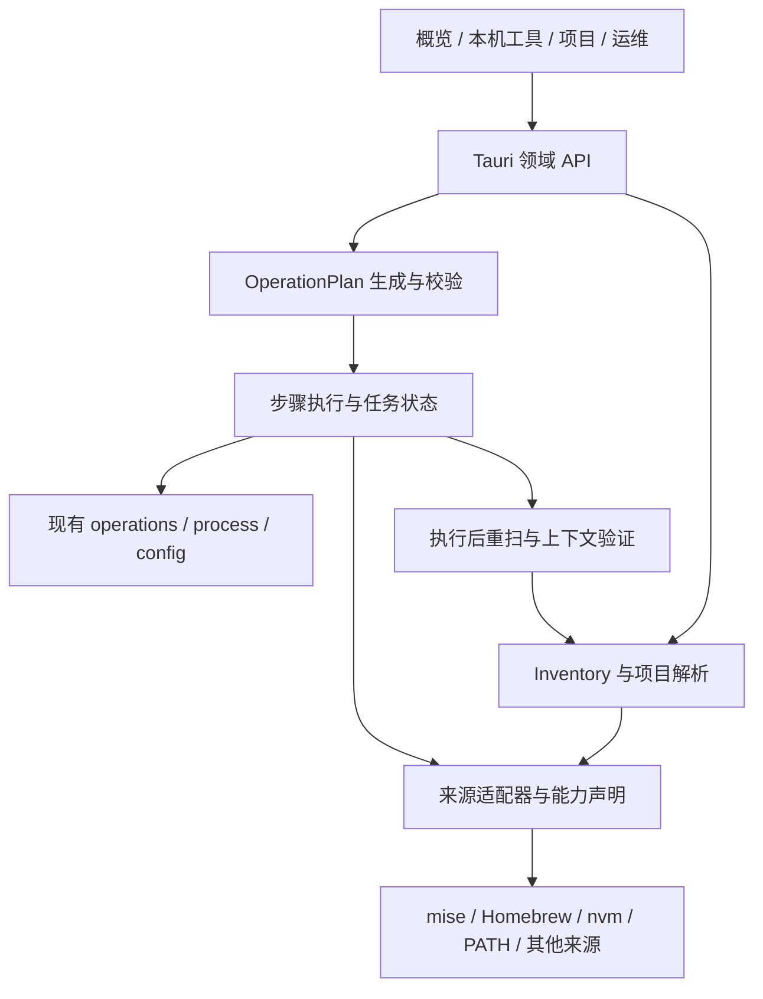

# 本机运行时与开发工具中心重构规划

日期：2026-10-19。状态：**首轮架构方案，保留 macOS 样板的历史范围**。

2026-10-20 用户确认将完成线扩为七类工具的三平台写操作闭环。
后续范围、固定渠道、十二个工作包及验收门槛以 [三平台实施方案](./cross-platform-implementation.md) 为准；
实施进度只在 [活计划](../plan.md) 维护。本文的“当前实现”及首批 PR 是当时的审计和设计，
不是 2026-10-20 的实时缺陷清单；P11、P13 macOS 限定范围及 P14 工作包 01–05 已实施。

本方案以 2026-10-19 的工作区为基线（`bd9928e`）；P9–P14 的实现已于 2026-10-20 分批次提交并合入 `main`。
阶段进度只在 [plan.md](../plan.md) 更新；本文保存目标、边界、实施顺序与验收契约。
历次对话及交接结论见 [工作区接手汇总](./archive/workspace-handoff-2026-10-19.md)。

## 1. 产品目标与取舍

Z.Env 的主对象是本机工具与项目环境。用户应能回答：机器上有什么、由谁安装、哪个项目需要它、
当前实际运行的是哪一份，以及下一次操作会改变什么。mise 负责它擅长的安装和绑定，作为一种可选 provider 接入。

主流程为：**发现本机工具 → 查看来源与实例 → 解析项目要求 → 选择操作 → 执行 → 验证结果 → 失败时恢复或解释残留**。

- 保留 Tauri 2、Rust、React 与现有视觉体系，逐条迁移用户流程。
- 保留配置服务、全局写操作互斥、任务取消、进程回收、精确版本托管与配置回滚。
- 首个纵向样板收窄到 **macOS + Node.js**：mise、Homebrew、nvm、PATH 的只读发现；
  首批写操作只开放经验证的 mise / Homebrew 能力。nvm 先只读，PATH 来源不提供卸载。
- Windows / Linux 的现有功能继续保留；macOS 样板通过不代表三平台新架构已验收。
- 首轮不引入通用插件 SDK、数据库迁移、云端同步、任意 shell 脚本执行或全量 UI 重写。
- 系统硬件监控作为辅助能力保留；先投入工具身份、来源容错和实际生效验证。

## 2. 当前实现与需要跨过的差距

以下来自本轮源码核对。既有修复与其实现前的缺陷分开记录，避免将 P9 已解决的问题再次立项。

| 领域 | 当前证据 | 重构要求 |
| --- | --- | --- |
| 工具发现 | [EnvironmentView.tsx](../src/components/EnvironmentView.tsx) 的 `refresh` 在前端合并 mise、外部来源和系统包；`Promise.all` 中 mise 失败会阻止外部结果发布，部分来源错误被转换为空数组 | 后端统一 inventory；每个来源独立返回结果、失败状态和时间 |
| 读取与修复 | 环境页刷新调用 `managedReconcile`；[managed.rs](../src-tauri/src/managed.rs) 的 `reconcile` 可能修复链接 | 列表、扫描、页面进入只读；修复由单独操作计划触发 |
| 工具身份 | [api.ts](../src/api.ts) 分别暴露 `ToolInfo`、`ToolSource`、`SystemPkg`；[packages.json](../src/data/packages.json) 已有规范包 ID | 工具定义、provider 包、安装实例、绑定与观测分别建模 |
| 版本与安装 | [InstallDialog.tsx](../src/components/InstallDialog.tsx) 可切换远程版本目录，安装仍固定调用 `installVersionStreaming` | 版本目录来源与执行安装的 provider 分开；版本可枚举不等于可精确安装 |
| 项目要求 | [discover.rs](../src-tauri/src/discover.rs) 的 `run` 只把 mise 已装工具名作为缺失判断依据，查询失败退化为空集 | 跨来源比较要求与候选实例；版本、选中状态、实际解析分别判断 |
| 执行上下文 | [process.rs](../src-tauri/src/process.rs) 的 `run` 为所有子进程设置 `mise::build_path()`；普通 mise 查询以 HOME 为工作目录 | 每条操作显式携带程序、参数、cwd、环境策略与作用域；项目验证使用项目上下文 |
| 任务 | [operations.rs](../src-tauri/src/operations.rs) 已有全局互斥、取消、部分失败和有界日志；记录仅在进程内 | 复用执行保障，补步骤、前置条件、验证与重启中断识别 |
| 配置 | [config.rs](../src-tauri/src/config.rs)、[project.rs](../src-tauri/src/project.rs) 已实现 TOML AST、原子保存、备份、外部修改检查与明确目标 | 新功能全部复用，禁止另建字符串替换写配置路径 |
| 快照 | [snapshot.rs](../src-tauri/src/snapshot.rs) v2 覆盖 mise 工具、可选全局 env、brew formula/cask；brew 恢复生成 Brewfile | 区分机器观测与可迁移意图；按目标平台能力生成重建计划 |
| 前端 | [App.tsx](../src/App.tsx) 已有按需加载、已访问页面状态保留；项目、软件、任务页面已有交互测试 | 替换数据和操作入口时保留草稿、键盘操作、错误重试、窄窗布局与加载行为 |

前置基线是 P9/P10 的完整现状。它们尚未发布，实施前应单独整理提交边界与验收记录；不能通过
清空工作区、覆盖源文件或重新从远端检出而丢失这些改动。

## 3. 领域模型与状态契约

### 3.1 对象的职责

| 对象 | 负责表达 | 关键字段或约束 |
| --- | --- | --- |
| `ToolDefinition` | 产品中的工具定义 | `toolId`、名称、类别、显式别名、可执行文件名；Node 与 nodejs 由映射归一，不猜测任意名称 |
| `ProviderPackage` | 渠道中的原生包身份 | `providerId`、原生 `packageId`、formula/cask、平台、架构；`node` 与 `node@22` 不混用 |
| `Installation` | 机器上的一个安装实例 | `installationId`、工具、provider 包、精确版本或未知、原路径、规范路径、架构、健康状态、证据 |
| `Binding` | 配置指向的实例或版本要求 | 绑定目标、global/project 作用域、配置文件位置、原始约束；绑定存在不证明实际生效 |
| `ProviderCapabilities` | 当前平台和工具可执行的动作 | 发现、版本目录、精确安装、渠道版本安装、卸载、绑定、权限、验证方式；返回可用性及原因 |
| `ProjectRequirement` | 项目声明的环境要求 | 来源文件、键、原值、解析约束、优先级与冲突；原文件保留 |
| `ProbeContext` / `ProbeResult` | 某个上下文中的实际结果 | cwd、环境策略、执行路径、退出码、版本、时间、是否已验证、限制 |
| `InventorySnapshot` | 一轮多来源观测 | 请求 ID、生成时间、provider 结果、实例、关联、局部错误、旧数据标记 |
| `OperationPlan` | 可审阅的变更及验证步骤 | 目标实例/包、前置条件、命令、配置差异、权限、取消点、补偿与不可回滚部分 |

### 3.2 身份与去重规则

1. 工具 ID 表达“Node.js”；包 ID 表达“Homebrew node@22”；安装 ID 表达“该机器此位置的这一份安装”。
2. 安装 ID 由 provider、原生包身份、安装定位符等稳定信息形成；版本或真实目标变化必须被识别为实例变化，
   不能让旧操作默默改向升级后的实体。路径大小写按平台规则处理，不统一转为小写。
3. 同工具、同版本、不同目录保留为不同实例。仅凭工具名或版本不得合并，也不得自动指定管理归属。
4. 规范路径和文件证据能证明 PATH、软链接与包管理器指向同一实体时，建立 alias 关联并保留所有来源证据。
   卸载权仍属于已证明拥有该实例的 provider；PATH 是发现方式。
5. 断链、无权限、版本未知、架构未知均保留为可展示的观测；规范化失败不能直接当作实例不存在。
6. 精确版本绑定继续使用现有托管规则：同包同版本可修复，跨版本更新生成新的显式计划。

### 3.3 状态分开表达

来源扫描状态采用 `ok / unavailable / unsupported / permissionDenied / timeout / cancelled / error`，
并携带覆盖范围、完成时间与截断标记。只有成功且覆盖完整的扫描才能对其范围作“未发现”判断。
provider 缺失、失败或扫描未完成时，工具状态为未知；其他成功来源照常展示。刷新失败时保留旧数据并标为过期。

界面分别表达：

- **安装**：检测到实例、健康、损坏、待验证。
- **要求满足**：满足、不满足、未知；依赖已解析的约束与候选版本。
- **绑定/选择**：已配置或未配置；注明全局/项目作用域。
- **实际解析**：某个 `ProbeContext` 中执行路径与版本是否符合预期。

应用进程继承 PATH、受控项目执行、用户新终端、IDE 是不同上下文。前两种验证不能被描述为后两种已生效。
软件安装命令成功后仍需重扫和验证；PATH 仍指向旧版时，应展示“已安装，当前上下文仍使用旧版”。

## 4. 后端与前端边界



建议按业务逐步形成以下目录；名称为目标设计，不表示这些文件已存在。

```text
src-tauri/src/
  domain/       工具、安装、绑定、项目要求、证据、操作计划
  inventory/    来源调度、合并、局部失败、缓存与过期状态
  providers/    固定注册的 mise / brew / nvm / path 适配器
  application/  查询、计划、执行、验证等用例
  operations.rs / process.rs / config.rs  先保留并渐进增强
src/
  api/          按领域拆分的 IPC 封装；旧 api.ts 作为过渡 re-export
  features/     inventory / projects / operations / diagnostics
  components/ui/ 与现有设计令牌
```

- Rust 负责身份、能力、合并、计划与验证；前端不再用多套数组自行判断“已安装”。
- `sources/` 当前提供的远程版本目录继续复用；它与 `providers/` 的安装、卸载能力分开。
- adapters 先用固定枚举或 trait 注册，复用旧函数；不在同一 PR 中移动所有文件。
- 领域错误使用结构化 code、provider、操作、可重试性和安全摘要；兼容层可转成现有错误字符串。
- 只读扫描使用每来源超时、目录/输出预算、有界并发、取消与请求代次；旧请求不能覆盖新快照。
  首个样板建议最多 4 个并发探针、单探针 3 秒，整体预算在 PR-02 实测后确定，均作为可测参数。
- version probe 使用明确的可执行路径和受控环境，避免加载 `NODE_OPTIONS` 等注入项；
  不 source 用户 rc、不自动运行项目 task、hook 或安装脚本。未知来源可先仅展示文件证据，等待显式验证。
  进程超时与资源预算不构成沙箱，也不能证明未知本地程序可信。
- `process::run` 改为接收明确环境策略，不能继续无条件覆盖调用方 PATH；旧路径通过兼容策略保持原行为。
- 写操作第一轮继续全局串行；来源读取可并发。资源级写锁在有实测需求时另行设计。

## 5. 信息架构与核心操作

导航定为五个主入口：**概览、本机工具、项目、服务与缓存、设置**。环境与诊断作为本机工具中的可直达区块，
避免同时维护“支持列表”与“环境”两套工具清单。快照与迁移从概览和设置进入，项目预设从项目页进入。

| 页面 | 主要问题与交付 |
| --- | --- |
| 概览 | 优先展示工具、项目待处理项、失败任务和诊断摘要；硬件指标保留为辅助区块 |
| 本机工具 | 已安装/可安装筛选共用同一目录；详情列出每个实例、归属、版本、路径、绑定、实际验证与可用操作 |
| 项目 | 展示声明来源、版本要求、候选实例、配置选择、受控上下文结果；缺失时给出有理由的安装/绑定建议 |
| 服务与缓存 | 分别列明 provider、归属、状态证据、可用动作、容量近似值、官方清理命令与平台限制 |
| 设置 | 主题、自启、更新、历史、扫描配置、快照与迁移；保留现有入口可达性 |

首个用户流程示例：机器存在 nvm Node 20 与 brew Node 22，项目要求 Node 22。
工具页同时显示两份实例；项目页可以判断候选版本，但若尚未完成上下文探测，实际生效显示未知。
用户选定 Node 22 后查看绑定计划，执行后记录配置差异并探测项目上下文；若仍解析到 Node 20，
显示差异与下一步处理方式，不能只因为安装或配置写入成功就报“环境就绪”。

实施中保留切页草稿、明确保存目标、失败重试、焦点恢复、任务日志和取消反馈。新旧入口在迁移期
可并存，但同一功能只能有一个业务写入口；只读失败不自动退回可能触发修复的旧刷新链。

## 6. 六阶段路线

编号承接 P10 / 39。下面是实施顺序；阶段只有满足退出条件后才能在活计划中标为完成。

| 阶段 | 交付物 | 依赖与退出条件 |
| --- | --- | --- |
| P11 / 40 多来源只读清单 | 身份/证据/状态契约；macOS Node 的 mise、brew、nvm、PATH adapters；inventory API 与统一详情；能力账本 | 无 mise 可查看外部 Node；同版本不同目录不串线；局部失败可解释；刷新不修复、不安装、不写配置；完成 PR-01–03 |
| P12 / 41 统一操作与验证 | 能力判断；计划预览、执行、重验、结果与中断记录；Node 安装/卸载/绑定闭环 | 依赖 P11；按精确目标执行，取消/失败明确残留；安装不等同生效；完成 PR-04–06 |
| P13 / 42 项目环境闭环 | 项目声明与冲突模型、候选解析、项目作用域验证；项目页接入同一 inventory 与计划 | 依赖 P11/P12；先支持明确版本、主版本、已约定范围；别名/复杂继承未支持时标未知；Node 要求 22 而实际 20 必须告警 |
| P14 / 43 工具目录与配方 | 按平台能力扩展 Python、Java、Go、Rust 及常用 CLI；预设与新项目初始化复用计划；工具页替换旧支持列表 | 每个工具/provider 单独补契约夹具与能力账本；配方能预览、部分失败、重试已失败步骤，不另建执行器 |
| P15 / 44 诊断与运维 | 只读 doctor、独立修复计划、PATH 差异预览与备份；服务/缓存接入归属、能力和统一任务 | 保留官方清理命令与目录预算；Windows 服务先有只读证据再开放写能力；定时巡检/托盘提醒在手动流程稳定后加入 |
| P16 / 45 快照迁移与旧入口收口 | 观测与迁移意图分离的新快照；v1/v2 读取；目标平台重建计划；移除已替换的旧入口 | 不迁移绝对路径作为目标机器绑定；秘密默认不导出；自动/手动步骤明确；完成旧功能回归和三平台实机、发布产物验收 |

平台差异贯穿每个阶段：未覆盖的能力显示原因，不能用隐藏按钮、空列表或假成功掩盖。
Intel Mac 产物与 Windows 服务仍是独立交付项；新增 CI 配置不等于已验收。

## 7. 前两阶段的六个 PR

这些是待创建的工作包编号，并非已创建的 GitHub PR。
依赖顺序：`PR-01 → PR-02 → PR-03 → PR-04 → PR-05 → PR-06`。

### PR-01：领域契约与纯合并器（P11）

- **范围**：定义 Tool/Package/Installation/Observation、provider 状态、alias 关系与快照格式；
  建立 Node 别名和 brew 原生包身份映射，提供纯函数合并器与 Rust/TS 序列化契约夹具。
- **触及**：新增 `domain/`、`inventory/` 的最小内核；扩展 API 类型，保持旧命令可调用。
- **验收**：同版本两目录保留两实例；真实同实体保留 alias 证据；坏链/未知版本/部分来源失败不丢记录；
  同输入产生稳定身份与排序，camelCase 与可空字段跨 IPC 一致。
- **回退**：新模型尚未参与写操作，可停用新读取入口；不迁移或删除旧清单。

### PR-02：macOS Node 只读 adapters 与探针（P11）

- **范围**：将现有 mise/nvm/brew 发现包装为独立结果，加入受限 PATH 发现和绝对路径 Node probe。
  记录 manager 不可用、超时、无权限、空结果、截断、取消和过期结果，禁止自动 reconcile。
- **触及**：`providers/`、`inventory/`，复用 `mise.rs` / `env.rs` 解析能力，给 `process.rs` 增加显式探针环境策略。
- **验收**：临时 HOME、伪 CLI、软链接目录覆盖有/无 mise、同版本多来源、brew 别名、断链、慢进程、
  不可执行文件和过量输出；一来源失败其余仍成功；扫描前后受保护配置及托管清单内容一致。
- **回退**：停用对应 adapter，返回 unsupported/unavailable；不把失败转换成成功的空扫描。

### PR-03：统一 inventory 查询与工具详情（P11）

- **范围**：新增 `inventory_snapshot` 查询和刷新取消；本机工具页读取一个快照，呈现来源状态、
  时间、实例、关联证据和未知项。旧“支持列表/运行时”入口先导向该详情，未迁移工具保持兼容展示。
- **触及**：Tauri 命令注册、API 封装、工具 feature、导航与查询状态；移出刷新链中的修复调用，
  旧托管修复保留显式入口并继续走全局互斥。
- **验收**：mise 缺失时 nvm Node 可见；刷新失败保留旧数据并标过期；旧请求不覆盖新请求；
  键盘可展开实例、重试来源；窄窗及明暗主题可用；访问页面无修复动作。
- **回退**：只读新入口可停用；受影响旧刷新也必须维持只读，不能恢复自动修复副作用。

### PR-04：能力判断与可审阅操作计划（P12）

2026-10-19 工作包已完成，实际开放范围与验证边界见 [计划及中断记录实施说明](./p12-operation-plans.md)。
新执行仅开放已有实例的只读重新验证，安装预览与能力限制已接入；写渠道按下列 PR-05/06 开放。

- **范围**：新增 `operation_plan` / `operation_execute`，由后端生成不可由前端任意拼接的结构化步骤。
  预览目标、provider、原生包、版本承诺、argv、cwd、环境键策略、配置差异、权限与回滚边界。
- **前置条件**：计划带 snapshot 代次、目标定位证据、配置原始内容指纹、有效期；执行前在写锁内重验。
  provider 状态、包身份、真实目标或配置变更时拒绝旧计划并重新预览，不能静默换源、换版本或扩大影响范围。
- **执行语义**：复用全局单写互斥与 TaskPanel；步骤区分 planned/running/completed/failed/skipped，
  任务区分 completed/partial/failed/cancelled/interrupted。取消请求不立即宣告已取消，补偿步骤也要报告结果。
- **中断**：最小本地 journal 只存任务 ID、步骤、安全摘要和结果；运行前原子记录，重启把未终结任务标为 interrupted，
  不自动重放安装。环境值、完整配置与秘密不写 journal；详细备份沿用配置服务。
- **验收**：计划过期、配置被改、目标升级、重复执行、并发进入、取消中和重启中断都有确定行为；
  journal 写入失败应在首个变更前报错。现有写锁、日志上限及子进程回收测试继续通过。
- **回退**：新动作暂不开放，已有动作沿原受保护入口运行；journal 可读取但不自动恢复任务。

### PR-05：Node 安装、卸载与结果验证（P12）

**2026-10-19 状态：渠道实现、故障验证与 mise 隔离实机闭环完成；Homebrew 真实写入验收待补。**
实现、证据与边界见 [PR-05 实施记录](./p12-node-operations.md)，本节范围和验收目标保留如下。

- **范围**：mise 精确版本安装与受支持卸载；Homebrew 使用原生 formula 身份，按渠道能力安装。
  版本目录可显示远端版本，但若渠道不能精确安装所选补丁版，必须在预览中明确并阻止错误承诺。
- **保护**：卸载仅针对证据充分的归属实例；brew formula 可能影响依赖，必须显示 provider 的影响信息，
  无法确定影响时保持手动处理。共享依赖不作为“回滚”自动卸载；nvm/PATH 实例不被转交其他 provider 删除。
- **验收**：使用伪 provider 验证精确参数、权限失败、退出码成功但实例缺失、版本不符、取消和部分完成；
  任何终态重扫涉及的来源并失效缓存，扫描失败则保留未验证状态。
  在可丢弃 macOS 环境补真实安装/卸载证据；安装成功但当前 PATH 仍旧时，显示两项独立结果。
- **回退**：停用新写能力，保留已成功下载内容与记录；不承诺包管理器安装具有事务回滚能力。

### PR-06：Node 绑定、解除绑定与补偿（P12）

**2026-10-19 状态：限定实现、故障验证和隔离实机流程完成。**
方式、范围、配置差异、私有收据与补偿边界见 [PR-06 实施记录](./p12-node-bindings.md)。
真实 Homebrew 和打包桌面 IPC 仍为 P12 门槛；以下保留原定目标。

- **范围**：复用 managed 接入和配置服务；按实例明确选择直连、托管或项目 PATH 绑定。
  绑定不等于转移原管理器所有权；解除绑定不删除原安装目录。
- **配置与验证**：显示目标文件和差异，沿用原内容校验、备份、原子写入；随后验证链接、mise 注册和
  相应全局/项目受控上下文。用户终端及 IDE 的状态另列未知或附手动验证步骤。
- **验收**：拒绝覆盖独立安装；来源升级后不跨版本重连；绑定失败恢复旧链接和本次配置，
  若配置已被外部再次修改，停止自动回滚并给出备份与冲突位置；取消后的补偿有独立结果。
  验证“要求 Node 22、实际 Node 20”不会显示环境就绪。
- **回退**：恢复本次仍满足原始内容检查的配置/链接，保留原来源；冲突或不可回滚步骤明确留痕。

## 8. 验证与完成标准

### 8.1 分层证据

| 层级 | 验证内容 | 能证明的边界 |
| --- | --- | --- |
| 纯函数与契约 | 身份、合并、能力、要求解析、计划、序列化 | 业务模型与边界规则 |
| 临时目录与伪 provider | 无 mise、断链、多实例、参数、环境、超时、取消、外部改写、部分失败、重启 | 本地执行协议、文件保护和错误处理；不能代替真实管理器兼容性 |
| React 模拟 IPC | 独立来源重试、过期数据、键盘/焦点、切页草稿、取消中、窄窗、深浅主题 | UI 合同；不能证明真实安装、提权或环境生效 |
| 可丢弃实机/虚拟机 | provider 实际输出、安装/卸载、shell/项目探针、授权、服务、快照、自动更新 | 对指定 OS/架构/provider 版本的实测支持 |
| 远程 CI 与发布 | 三平台构建、签名、产物、更新元数据、安装启动 | CI、发布和用户机器验收各自单列记录 |

### 8.2 按阶段能力覆盖的关键场景

每阶段覆盖本次新增或受影响的能力，并保留相关 P9/P10 回归。P11 以场景 1–4 的只读部分为退出条件；
场景 5–7 随 P12/P13 能力进入门禁，后续阶段扩展到新增工具及平台；P16 收口执行完整矩阵。

1. mise 不存在或查询失败，外部 Node 仍可见；所有来源失败时显示未知及原因。
2. 同版本多来源/多目录分别可操作；同实体别名不被误判为两份可卸载安装。
3. 断链、权限拒绝、未知版本、超时、取消和截断均可解释；刷新不修改配置和托管状态。
4. 重复刷新、切页和旧响应不会覆盖新状态；任务日志按任务隔离。
5. 安装成功、配置成功、项目要求满足、实际解析正确分别判断。
6. 项目要求 Node 22，机器存在 Node 20 或项目实际仍使用 20 时不误报满足。
7. 执行前目标升级、执行中配置外部改写、验证失败、取消后补偿失败均不覆盖他人新改动。
8. 本地路径、环境值和原始 CLI 输出按现有日志规则处理；持久历史/journal 不新增秘密副本。

阶段验收记录采用：OS/架构、provider 及版本、场景、预期、观测、证据路径、结论、未覆盖项。
更新能力账本时分别标识“实现、自动验证、实机验证、发布”；不以测试总数代替场景通过。

### 8.3 规划接手轮次的验证（实施前）

2026-10-19 已重新执行：前端 11 个测试文件 / 67 项通过，Rust 57 项通过。
其他检查结果见 [接手汇总](./archive/workspace-handoff-2026-10-19.md)；本轮交付仅为文档与对话归档，
没有新增 provider 或执行真实安装、卸载、服务启停、缓存清理。旧 P9/P10 的实机边界继续适用。
后续 PR-01 的代码与当前验证单独记在 [领域契约实施记录](./p11-inventory-contracts.md)。
PR-02 的来源与探针验证见 [Node 只读来源实施记录](./p11-node-sources.md)。
PR-03 的查询、界面、P11 能力账本及验证边界见 [清单详情实施记录](./p11-inventory-ui.md)。
PR-04 的能力、执行前重验、journal、取消与中断状态见 [P12 实施记录](./p12-operation-plans.md)。

后续实现按仓库现有命令执行：

```sh
npm run check:version
npm run lint
npm run format:check
npm test
npm run build
npm audit --audit-level=high
cargo fmt --manifest-path src-tauri/Cargo.toml -- --check
cargo clippy --manifest-path src-tauri/Cargo.toml --all-targets -- -D warnings
cargo test --manifest-path src-tauri/Cargo.toml
cargo build --manifest-path src-tauri/Cargo.toml
```

## 9. 风险、迁移与下一步

- **工作区与发布基线**：先把已有 P9/P10 的改动作为可追溯基线保留下来，再落 PR-01；
  提交如何拆分由实际依赖决定，不把大批可靠性修改伪装成纯架构移动。版本字段仍为 0.7.1，发布状态另行核实。
- **provider 差异**：能力必须按平台和工具细分。Homebrew 的当前 formula 版本、nvm 的 shell 函数特征、
  Windows 包身份与 Linux 授权分别处理，不能从某一渠道的功能推导全部可用。
- **配置兼容**：新模型包裹现有 TOML 与托管数据，早期不做破坏性迁移。快照新格式在 P16 独立版本化，
  保留旧读取器和旧样本回归；未知未来版本拒绝恢复。
- **操作不可逆部分**：下载、包管理器依赖变化和外部进程副作用不保证可撤销；计划提前列出，失败报告残留与下一步。
- **范围膨胀**：先完成 Node 的六个 PR，再按同一合同扩展；PATH 自动清理、定时体检和新平台服务不能抢在基础状态模型前。
- **成本与排期**：以验收门禁推进，不在缺少 adapter 性能与平台样本时承诺日期。
  PR-02 测量扫描耗时与输出规模，PR-05 记录真实安装/验证成功率；据此估算后续工具接入成本。

首个阶段的 **PR-01–03** 已完成，P11 按 macOS Node 只读试点的代码与场景证据退出；
PR-04 的能力判断与操作计划已完成；PR-05 的安装/卸载渠道实现与 mise 实机闭环已完成，Homebrew 真实写入验收仍待补。PR-06 的限定绑定实现、故障验证与隔离实机流程也已完成。P13 的 macOS Node 项目环境限定范围已完成，见 [实施记录](./p13-project-environment.md)；声明、候选、配置与受控/应用 PATH/终端分开判断，复杂隐式配置保持未知。P14 的[目录与导航工作包](./p14-tool-catalog.md)已完成，[Python 五来源只读清单](./p14-python-sources.md)也已完成；[Python 安装计划预览与受控重新验证](./p14-python-plans.md)也已接入；[Python mise 写渠道](./p14-python-mise.md)也已完成限定实机闭环；其他真实渠道、绑定、工具适配及项目配方仍在后续范围，P14 保持进行中；P12 的渠道和桌面验收门槛继续保留。执行位置与阶段状态统一见活计划，P11 完成不作为整项重构或发布完成的标志。
